  

  
  
  
  
  

---

# 🚀 Awesome API Uptime & Performance Monitoring

> A curated list of the best **API uptime monitoring**, **synthetic transaction testing**, **health check monitors**, **status page tools**, and **application performance observability (APM)** platforms.

Whether you run mission-critical microservices, public REST/GraphQL APIs, or developer-facing webhooks, proactive uptime monitoring ensures your infrastructure meets strict Service Level Agreements (SLAs) and alerts your incident response team before your customers notice downtime.

---

## 📑 Table of Contents
- [📊 Sector Overview & Market Dynamics](#-sector-overview--market-dynamics)
- [🏢 SaaS & Cloud Monitoring Platforms](#-saas--cloud-monitoring-platforms)
- [💻 Open-Source Monitoring & Status Page Tools](#-open-source-monitoring--status-page-tools)
- [🔍 Key Evaluation Criteria](#-key-evaluation-criteria)
- [📈 Star History](#-star-history)
- [💖 Support & Sponsorship](#-support--sponsorship)
- [🤝 Contributing](#-contributing)

---

## 📊 Sector Overview & Market Dynamics

The global synthetic and API uptime monitoring sector is valued at approximately **$3.7 billion** and is projected to expand to **$14.6 billion by 2035** at a rapid **16.5% CAGR**, driven by cloud-native microservices architectures, distributed edge computing, and strict SLA compliance requirements. 

The market is **moderately fragmented**: high-end enterprise telemetry is anchored by concentrated multi-billion-dollar observability suites (e.g., Datadog, Dynatrace), while the lightweight endpoint ping, synthetic testing, and status page ecosystem remains open and competitive with specialized developer-first platforms and vibrant open-source self-hosted alternatives.

---

## 🏢 SaaS & Cloud Monitoring Platforms

The following SaaS solutions are sorted in descending order by company scale (**Market Capitalization / Valuation / Revenue**):

| Vendor | Company Scale (Valuation / Revenue) | Starting Pricing (Specific Entry Tier) | Free Tier / Trial Limits | Key Capabilities |
|---|---|---|---|---|
| **[Datadog](https://www.datadoghq.com/)** | **~$68B Market Cap** (~$4.3B TTM Revenue) | **$5.00 / month** per 10,000 synthetic API test runs ($12.00 / 1k browser runs) | **14-day free trial** with full synthetic testing access; no permanent free tier for synthetics (free tier is limited to 5 infra hosts) | Multi-step API tests, global endpoints, SSL tracking, distributed tracing, full observability |
| **[Dynatrace](https://www.dynatrace.com/)** | **~$18.5B Market Cap** (~$2.18B TTM Revenue) | **$0.001 / request** for HTTP API monitors (~$1.00 / 1k checks); $0.0045 / synthetic action | **15-day free trial** with platform sandbox; no permanent free tier | AI-driven root cause analysis (Davis AI), enterprise synthetic scripts, global multi-cloud probes |
| **[Zoho Site24x7](https://www.site24x7.com/)** | **~$12B Valuation** (~$1.5B Zoho Corp Revenue; ~$50M ARR product) | **$9.00 / month** (billed annually, Starter/Basic tier for 10 websites/servers) | **Free Forever**: 50 website/port monitors checked every 5 minutes from 1 global location, email alerts only, 1 status page | Global uptime checks, REST API monitoring, SSL/TLS cert expiry, DNS/Ping, public status pages |
| **[New Relic](https://newrelic.com/)** | **$6.5B Valuation** (Acquired by Francisco Partners & TPG; ~$1B ARR) | **Usage-based** at $0.005 / check beyond free allotment (Full platform user from $49/user/mo) | **Free Forever**: 500 synthetic checks / month + 100 GB / month data ingest with 1 full user license | Programmable API checks, scripted synthetic browser tests, OpenTelemetry native ingestion |
| **[Pingdom](https://www.pingdom.com/)** (SolarWinds) | **$4.4B Acquisition** (SolarWinds acquired by Turn/River; ~$797M TTM Revenue) | **$18.00 / month** (billed monthly, 10 uptime checks + 1 advanced check + 50 SMS) | **14-day free trial** with complete Synthetic and RUM feature access; no permanent free plan | Synthetic endpoint polling, transaction flow testing, root-cause analysis, uptime reporting |
| **[Checkly](https://www.checklyhq.com/)** | **~$32M+ Raised / ~$50M+ Valuation** (~$7M ARR; Series B funded) | **$24.00 / month** (annual billing for Starter Detect plan: 50k API checks, 2.5k browser checks) | **Free Forever (Hobby Plan)**: 10 monitors, 10,000 API checks / month, 1,000 browser checks / month, 5 users | Code-first synthetic monitoring via Playwright & TypeScript, GitHub Actions CI/CD integration |
| **[UptimeRobot](https://uptimerobot.com/)** | **~$10M ARR** (Privately held / bootstrapped leader) | **$9.00 / month** (Solo plan: 10 monitors, 60-second check intervals, SMS/voice alerts) | **Free Forever**: 50 monitors, 5-minute check frequency, HTTP(s)/Ping/Port checks, 1 status page | Ping, HTTP(s), keyword, and port monitoring, status pages, incident webhook alerting |
| **[Better Stack](https://betterstack.com/)** | **~$29M Raised / ~$60M+ Valuation** (~$5M ARR; Profitable) | **$29.00 / month** (billed annually per responder seat; 30s checks, unlimited call/SMS alerts) | **Free Forever**: 10 monitors & heartbeats (3-minute checks), 1 status page, Slack/email alerts, 3 GB logs | Modern UI, cron/heartbeat checks, built-in incident on-call escalation, status pages, log tailing |

---

## 💻 Open-Source Monitoring & Status Page Tools

Self-hosted and developer-friendly open-source tools sorted in descending order by **GitHub Stars** count:

| Project | GitHub Stars | Technology Stack | Description |
|---|---|---|---|
| **[Uptime Kuma](https://github.com/louislam/uptime-kuma)** |  | Node.js / Vue.js / SQLite | A self-hosted, feature-packed monitoring tool with support for HTTP(s), TCP, Ping, DNS, Docker, beautiful status pages, and 90+ notification dispatchers. |
| **[Upptime](https://github.com/upptime/upptime)** |  | GitHub Actions / TypeScript | An open-source uptime monitor and status page powered entirely serverless by GitHub Actions, GitHub Issues, and GitHub Pages. |
| **[Gatus](https://github.com/TwiN/gatus)** |  | Go | Automated developer-oriented service health dashboard supporting HTTP, ICMP, TCP, DNS queries, and custom condition evaluations. |
| **[Healthchecks](https://github.com/healthchecks/healthchecks)** |  | Python / Django | A cron job and periodic task monitoring service that listens for pings ("dead man's switches") from scheduled tasks and background workers. |
| **[Statping](https://github.com/hunterlong/statping)** |  | Go / Vue.js | An open-source status page and monitoring server with graphs, analytics, incident reporting, and multi-channel notifications. |
| **[Prometheus Blackbox Exporter](https://github.com/prometheus/blackbox_exporter)** |  | Go | The de facto Kubernetes and Prometheus probing daemon for blackbox probing of endpoints over HTTP, HTTPS, DNS, TCP, and ICMP. |
| **[Monitoror](https://github.com/monitoror/monitoror)** |  | Go / Vue.js | Unified wallboard and monitoring display engine for tracking servers, CI/CD pipelines, and HTTP endpoints on office status screens. |
| **[Statping-ng](https://github.com/statping-ng/statping-ng)** |  | Go / Vue.js | Community-driven fork of Statping fixing modern container builds and incident management for self-hosted status pages. |
| **[Kuvasz](https://github.com/kuvasz-uptime/kuvasz)** |  | Kotlin / Micronaut | Lightweight and resilient open-source uptime, SSL certificate expiry, and latency monitoring backend with Slack/Telegram alerts. |
| **[Upstat](https://github.com/chamanbravo/upstat)** |  | Go / React / Tailwind | Lightweight self-hosted status monitoring tool featuring endpoint latency response charts, Discord alerts, and Docker deployment. |

---

## 🔍 Key Evaluation Criteria

When selecting an API and uptime monitoring solution, assess the following factors:

1. **Check Frequency:** Can the monitor run sub-minute checks (e.g., 30s or 15s) or only 5-minute polling intervals?
2. **Multi-Step Synthetics:** Does the tool support chaining HTTP calls (extracting auth tokens from a POST request and passing them into subsequent GET calls)?
3. **Global Probes:** How many geolocated probe stations are available to distinguish local ISP drops from global service outages?
4. **Alert Routing & Escalation:** Are incidents delivered via SMS, voice call, Slack, PagerDuty, Opsgenie, or Webhooks?
5. **Cost Model:** Compare monitor-based flat pricing (e.g., $9/mo for 10 monitors) with per-test consumption billing (e.g., Datadog's $5 per 10k runs).

---

## 📈 Star History

---

## 💖 Support & Sponsorship

Thank you for exploring and utilizing this curated collection! If you find this guide valuable for your production systems and developer workflows, please consider supporting the project:

- ⭐ **Star this repository** to help others discover it on GitHub.
- 🍴 **Fork and contribute** your favorite monitoring tools and battle-tested recipes.
- 📢 **Share with colleagues** in DevOps, SRE, and API engineering teams.
- ☕ **Buy me a coffee / Sponsor:** Support ongoing maintenance and curated open-source research directly via the **[GitHub Sponsors Dashboard](https://github.com/sponsors/ishandutta2007)**.

---

## 🤝 Contributing

Contributions, issues, and feature suggestions are always welcome! Please feel free to open a pull request or submit an issue to suggest additions or updates to the curated list.
